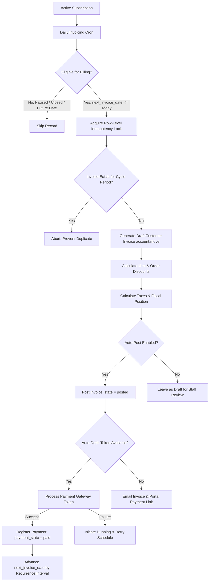

# Brightloop Subscription Management System — Billing & Invoicing Specification

## Document Overview
- **Document Version:** 1.1.0
- **Status:** Approved Baseline / Active
- **Module Ownership:** `brightloop_billing`, `brightloop_subscription`, `brightloop_base`
- **Target ERP Platform:** Odoo 19 (Community/Enterprise)

---

## 1. Core Billing Architecture & Principles

The Brightloop billing engine coordinates automated recurring invoice generation, payment processing, tax accounting, and dunning management.

---

## 2. Requirement Traceability Matrix

### 2.1 Recurring Invoicing & Billing Schedules

| Req ID | Parameter / Scenario | Exact Expected Behaviour | User Role | Expected System Result | Relevant Module | Acceptance Criteria |
|---|---|---|---|---|---|---|
| **REQ-BILL-001** | **Billing Cadence (Daily, Weekly, Monthly, Yearly)** | Subscriptions must generate recurring invoices on defined intervals: Daily, Weekly, Monthly, Quarterly, Semi-Annual, Annual. | MGR, STAF | Invoicing interval configured via `billing_interval_number` and `billing_interval_unit`. | `brightloop_billing`, `brightloop_subscription` | 1. Recurrence unit supports: `day`, `week`, `month`, `year`. 2. Daily: billing period is 1 day. Weekly: 7 days. Monthly: calendar month. Yearly: 1 calendar year. 3. Interval multiplier $\ge 1$. 4. Interval cannot be modified once subscription is active without formal amendment. |
| **REQ-BILL-002** | **Next Billing Date Calculation** | The `next_invoice_date` must advance predictably without date drift or cumulative day-loss across consecutive months. | SYSTEM (Cron) | Upon invoice posting, `next_invoice_date` is updated using relative calendar addition based on subscription anchor date. | `brightloop_billing` | 1. Month-end clamping: Jan 31 + 1 month = Feb 28 (or Feb 29 in leap year). 2. Anchor retention: Feb 28 + 1 month snaps back to March 31 if anchor day was 31. 3. Advance billing generates invoice on or before cycle start date; arrears billing generates on cycle end date. |
| **REQ-BILL-003** | **Invoice Generation Preconditions** | System must verify operational prerequisites prior to invoice generation. | SYSTEM (Cron), STAF | Invoicing engine evaluates: (a) `state == 'active'`, (b) `is_paused == False`, (c) `next_invoice_date <= today`, (d) customer has valid billing address and currency. | `brightloop_billing` | 1. Paused subscriptions are completely skipped by billing cron. 2. Closed/draft subscriptions are excluded from billing query domain. 3. Missing billing address raises actionable notification to staff. |
| **REQ-BILL-004** | **Duplicate Invoice Prevention (Idempotency)** | System must strictly prevent multiple invoices from being created for the same subscription billing period. | SYSTEM (Cron), STAF | Database unique constraint and code guard enforce one invoice per subscription period (`subscription_id`, `period_start_date`, `period_end_date`). | `brightloop_billing` | 1. Concurrent cron executions or manual button clicks cannot generate duplicate invoices. 2. If an open draft or posted invoice already covers the date range, secondary creation is rejected. 3. Unique key: `(subscription_id, period_start_date, period_end_date)`. |
| **REQ-BILL-005** | **Missed Billing Catch-Up** | In the event of system downtime or server outage, billing cron must safely generate invoices for any past-due missed cycles without skipping periods. | SYSTEM (Cron) | Cron identifies subscriptions where `next_invoice_date < today` and iterates consecutively through overdue intervals. | `brightloop_billing` | 1. Subscriptions do not skip intervals if cron fails to run for multiple days/weeks. 2. Separate invoices generated for each elapsed billing cycle with accurate historic period labels. 3. Execution throttled in configurable batch sizes (default: 50 records/batch). |
| **REQ-BILL-014** | **Billing Period Calculation & Line Item Labeling** | Every invoice line generated from a subscription must clearly specify the exact coverage period (`period_start` to `period_end`) in its description. | SYSTEM (Cron) | Line description formats: `"[Product Name] - Coverage: YYYY-MM-DD to YYYY-MM-DD"`. | `brightloop_billing` | 1. `period_start` is inclusive; `period_end` is inclusive. 2. Monthly: `2026-11-01` to `2026-11-30`. 3. Prorated periods explicitly state fractional dates. |

---

### 2.2 Invoice States, Taxes, Sending & Payment Tracking

| Req ID | Parameter / Scenario | Exact Expected Behaviour | User Role | Expected System Result | Relevant Module | Acceptance Criteria |
|---|---|---|---|---|---|---|
| **REQ-BILL-006** | **Invoice Lifecycle States** | Invoices generated by subscription must strictly follow Odoo accounting states: `Draft` $\rightarrow$ `Posted` $\rightarrow$ `Paid` / `In Payment` / `Cancelled` / `Reversed`. | STAF, MGR, SYSTEM | Standard `account.move` lifecycle is enforced with subscription metadata linkage. | `brightloop_billing` | 1. Auto-post setting controls whether invoices generate as `Draft` or automatically transition to `Posted`. 2. Cancelled invoices require credit note generation if already posted. 3. Invoice header includes back-reference to origin `subscription_id`. |
| **REQ-BILL-007** | **Tax Calculation & Fiscal Positions** | Invoices must accurately calculate taxes based on customer fiscal position, location, and product tax rules (both Tax-Exclusive and Tax-Inclusive). | MGR, STAF | Odoo `account.tax` engine computes line-level and total taxes using applicable rate matrices. | `brightloop_billing`, `brightloop_base` | 1. Tax-exclusive: $\text{Total} = \text{Subtotal} + (\text{Subtotal} \times \text{Rate})$. 2. Tax-inclusive: $\text{Subtotal} = \text{Total} / (1 + \text{Rate})$. 3. Multi-tax scenarios (e.g. State + Municipal tax) supported. 4. Zero-rated/tax-exempt customers correctly mapped via Fiscal Position. |
| **REQ-BILL-008** | **Payment Registration & Reconciliation** | Payments recorded against subscription invoices must reconcile invoice lines and update `payment_state`. | STAF, CUST | Payment linked to `account.payment` record and reconciled against debtor receivable account. | `brightloop_billing` | 1. Full payment transitions `payment_state` to `paid`. 2. Partial payment transitions `payment_state` to `partial` with residual balance displayed. 3. Multiple partial payments allowed until residual reaches zero. 4. Overpayments create customer credit balance on partner ledger. |
| **REQ-BILL-009** | **Due Date & Payment Terms** | Every invoice must carry an explicit due date (`invoice_date_due`) calculated from assigned payment terms (e.g. Immediate, Net 15, Net 30). | STAF, MGR | `account.payment.term` calculates due date relative to `invoice_date`. | `brightloop_billing` | 1. Due date computation accounts for end-of-month and day-offset rules. 2. Immediate payment invoices have `invoice_date_due == invoice_date`. |
| **REQ-BILL-010** | **Outstanding & Overdue Logic** | Invoices unpaid past `invoice_date_due` must be classified as Overdue and initiate dunning aging buckets. | SYSTEM (Cron) | Invoice tracked in aging buckets: `Current` ($\le 0$ days past due), `Late 1-15`, `Overdue 16-30`, `Default > 30`. | `brightloop_billing` | 1. Overdue flag is dynamic: `today > invoice_date_due` and `payment_state not in ('paid', 'in_payment')`. 2. Residual amount tracked accurately in company currency. |
| **REQ-BILL-015** | **Invoice Sending and Printing** | Once posted, subscription invoices must support automated email delivery with PDF attachment and portal download. | SYSTEM, STAF | Customer receives email containing PDF invoice and one-click payment URL (`/my/invoices/<id>`). | `brightloop_billing`, `brightloop_portal` | 1. Email template `email_template_subscription_invoice` triggered upon posting. 2. Chatter records message sent timestamp and PDF delivery confirmation. 3. Evaluator accounts receive mock email record in mail queue. |
| **REQ-BILL-016** | **Payment References & Transaction Notes** | Every registered payment must capture mandatory payment reference, gateway transaction ID, and internal audit notes. | STAF, SYSTEM | `account.payment` populates `ref` (e.g. `PAY-SUB-2026/001`), `payment_reference`, and gateway token payload. | `brightloop_billing` | 1. Prevents duplicate payment registrations against same transaction ID. 2. Detailed payment notes stored in Odoo chatter. |
| **REQ-BILL-017** | **Subscription Status Billing Guards (Paused, Closed, Renewed)** | Automated invoicing must enforce strict guards based on subscription status: Paused = freeze, Closed = terminate, Renewed = continue on new term. | SYSTEM (Cron) | Recurring billing domain checks `subscription_id.state` and `is_paused`. | `brightloop_billing` | 1. Paused subscriptions generate NO invoices. 2. Closed subscriptions are purged from active billing queues. 3. Renewed subscriptions seamlessly transition to next billing period with new commitment dates. |
| **REQ-BILL-018** | **Failed Invoice Creation Rollback Handling** | If an exception occurs during invoice creation (e.g. missing tax account, locked accounting period), system must roll back cleanly without leaving orphan records. | SYSTEM (Cron) | Transaction wrapped in database savepoint; error logged to chatter; subscription flagged `billing_exception = True`. | `brightloop_billing` | 1. No partial/broken `account.move` records created. 2. `next_invoice_date` is NOT advanced. 3. System administrator alerted via activity notification. |

---

### 2.3 Failed Billing, Retry Logic & Dunning

| Req ID | Parameter / Scenario | Exact Expected Behaviour | User Role | Expected System Result | Relevant Module | Acceptance Criteria |
|---|---|---|---|---|---|---|
| **REQ-BILL-011** | **Payment Decline Handling** | When an automated payment attempt fails (token charge failure), system must log decline reason code and retain invoice in `Posted` / `Not Paid` state. | SYSTEM (Webhook) | Payment transaction record marked `error`; error message recorded in chatter; retry counter incremented. | `brightloop_billing` | 1. Distinguish Soft Declines (insufficient funds, temporary network error) from Hard Declines (card expired, stolen/blocked). 2. Failed attempt does NOT cancel invoice or reset `next_invoice_date`. |
| **REQ-BILL-012** | **Automated Retry Schedule** | System must execute exponential backoff retries for soft-declined subscription invoices. | SYSTEM (Cron) | Automated retry cron re-attempts payment on scheduled intervals: Day +1, Day +3, Day +7. | `brightloop_billing` | 1. Maximum of 3 automatic retries. 2. Hard declines bypass retry schedule and escalate immediately to customer notification. 3. Each retry attempt logged in subscription chatter with timestamp. |
| **REQ-BILL-013** | **Dunning Escalation & Non-Payment Closure** | If payment remains unpaid after final retry and exceeds plan grace period (default: 15 days), system automatically terminates subscription. | SYSTEM (Cron) | Subscription transitions to `Closed` with reason "Automatic Closure: Non-Payment"; notification dispatched to customer and credit control. | `brightloop_billing`, `brightloop_subscription` | 1. Day 1: First payment failure notification. 2. Day 7: Urgent payment reminder & portal update link. 3. Day 15 (Grace end): Subscription closed; service entitlement revoked; invoice remains posted for collection. |

---

## 3. Detailed Calculation Formulas & Boundary Rules

### 3.1 Next Billing Date Computation

Let $D_{anchor}$ be the initial subscription start day of month (e.g., 31).
For monthly interval addition from date $T = (Y_0, M_0, D_0)$ to next month $M_1 = M_0 + 1$:
$$D_{target} = \min(D_{anchor}, \text{DaysInMonth}(Y_1, M_1))$$
$$\text{NextDate} = (Y_1, M_1, D_{target})$$

*Example:*
- Start Date: January 31, 2028 (Leap Year)
- Cycle 1: $\min(31, 29) \rightarrow$ February 29, 2028
- Cycle 2: $\min(31, 31) \rightarrow$ March 31, 2028
- Cycle 3: $\min(31, 30) \rightarrow$ April 30, 2028

### 3.2 Tax Calculation Models

#### Model A: Tax-Exclusive (Standard B2B)
$$\text{Line Subtotal} = \text{Unit Price} \times \text{Quantity} \times (1 - \text{Discount Rate})$$
$$\text{Tax Amount} = \text{Line Subtotal} \times \text{Tax Rate}$$
$$\text{Total Invoice Amount} = \sum \text{Line Subtotal} + \sum \text{Tax Amount}$$

#### Model B: Tax-Inclusive (Standard B2C / Retail)
$$\text{Line Total (Gross)} = \text{Gross Unit Price} \times \text{Quantity} \times (1 - \text{Discount Rate})$$
$$\text{Line Subtotal (Net)} = \frac{\text{Line Total (Gross)}}{1 + \text{Tax Rate}}$$
$$\text{Tax Amount} = \text{Line Total (Gross)} - \text{Line Subtotal (Net)}$$

*Rounding Rule:*
All currency conversions and intermediate tax lines must be rounded according to `currency_id.rounding` (e.g. 0.01 for USD/EUR, 1.0 for JPY) using half-up arithmetic (`ROUND_HALF_UP`).
