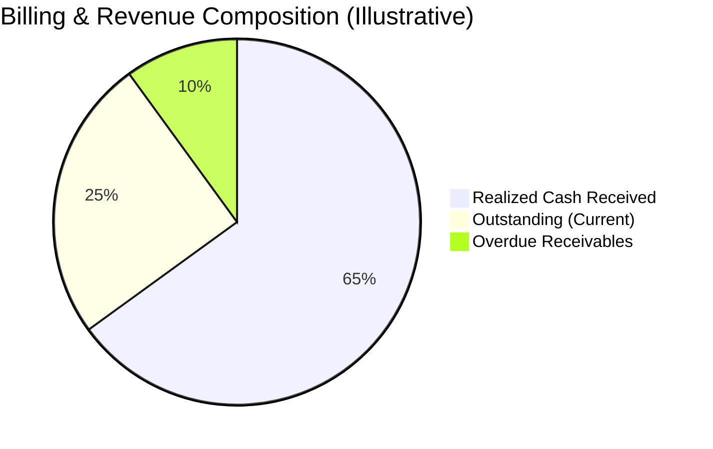

# Brightloop Subscription Management System — Dashboard KPI Definitions & Metrics Specification

## Document Overview
- **Document Version:** 1.1.0
- **Status:** Approved Baseline / Active
- **Module Ownership:** `brightloop_dashboard`, `brightloop_billing`, `brightloop_subscription`
- **Target ERP Platform:** Odoo 19 (Community/Enterprise)

---

## 1. Executive Summary & Financial Distinctions

A critical principle of Brightloop financial reporting is the strict segregation between:
1. **Accrual Invoiced Revenue:** Value of goods/services legally billed via posted invoices (accounts receivable credit), regardless of collection.
2. **Cash Received (Realized Cash Flow):** Actual cash funds collected and reconciled via payment journals into company bank accounts.
3. **Outstanding Receivables:** Contracted billed amounts currently unpaid by customers.



---

## 2. Core Dashboard KPI Specifications

### KPI-01: Active Subscriptions
- **Business Definition:** Total count of active, revenue-generating customer subscriptions currently entitled to services.
- **Data Source:** Model `brightloop.subscription`.
- **Calculation Logic:**
  $$\text{Active Subscriptions} = \text{Count}(\text{id})$$
- **ORM Domain / SQL Filter:**
  ```python
  [
      ('state', '=', 'active'),
      ('is_paused', '=', False),
      ('date_start', '<=', fields.Date.today()),
      '|',
      ('commitment_end_date', '=', False),
      ('commitment_end_date', '>=', fields.Date.today())
  ]
  ```
- **Date Range:** Current point-in-time snapshot.
- **Filters & Exclusions:** Exclude `draft`, `quotation`, `confirmed`, `closed`. Exclude paused records (`is_paused = True`).
- **Expected Result:** Positive integer representing live active contracts (e.g. `1,250`).
- **Example Calculation:**
  - Total records in system: 1,500
  - Draft quotes: 150
  - Closed contracts: 80
  - Paused subscriptions: 20
  - Active running contracts: $1,500 - 150 - 80 - 20 = \mathbf{1,250}$.

---

### KPI-02: Total Invoiced Revenue (Gross & Net)
- **Business Definition:** The aggregate monetary value of all legally posted customer invoices originated from subscription contracts within a selected date window.
- **Data Source:** Model `account.move` linked via `subscription_id`.
- **Calculation Logic:**
  $$\text{Total Invoiced Revenue} = \sum_{\text{invoices}} \text{amount\_untaxed\_signed}$$
- **ORM Domain / SQL Filter:**
  ```python
  [
      ('move_type', '=', 'out_invoice'),
      ('state', '=', 'posted'),
      ('subscription_id', '!=', False),
      ('invoice_date', '>=', start_date),
      ('invoice_date', '<=', end_date)
  ]
  ```
- **Date Range:** Filterable: Month-to-Date (MTD), Quarter-to-Date (QTD), Year-to-Date (YTD), Custom Range.
- **Filters & Exclusions:** Must exclude `state == 'draft'` and `state == 'cancel'`. Credit notes (`out_refund`) are automatically netted via signed amounts.
- **Expected Result:** Monetary amount in company currency (e.g. `$125,000.00`).
- **Example Calculation:**
  - 100 posted monthly subscription invoices @ $1,000 untaxed each = $100,000.00
  - 1 credit note issued for SLA rebate = -$2,000.00
  - Net Total Invoiced Revenue = $\$100,000.00 - \$2,000.00 = \mathbf{\$98,000.00}$.

---

### KPI-03: Posted Accounting Revenue (Earned Accrual)
- **Business Definition:** The total revenue legally recognized in company general ledger revenue accounts (`400000 Product Sales / Services`) for the selected accounting period.
- **Data Source:** Model `account.move.line`.
- **Calculation Logic:**
  $$\text{Posted Accounting Revenue} = \sum_{\text{credit lines}} \text{credit} - \sum_{\text{debit lines}} \text{debit} \quad (\text{Account Type} = \text{'income'})$$
- **ORM Domain / SQL Filter:**
  ```python
  [
      ('move_id.subscription_id', '!=', False),
      ('move_id.state', '=', 'posted'),
      ('account_id.account_type', '=', 'income'),
      ('date', '>=', start_date),
      ('date', '<=', end_date)
  ]
  ```
- **Date Range:** Accounting accounting date (`date`).
- **Filters & Exclusions:** Strictly posted journal items only. Excludes tax liability lines and accounts receivable balance sheet entries.
- **Expected Result:** Monetary balance matching General Ledger income report.
- **Example Calculation:**
  - Invoice: $1,000 subscription + $100 tax.
  - Accounts Receivable (Debit): $1,100
  - Tax Payable (Credit): $100
  - Income Account (Credit): $1,000 $\implies$ Posted Accounting Revenue = $\mathbf{\$1,000.00}$.

---

### KPI-04: Payments Received (Cash Flow)
- **Business Definition:** The actual liquid cash funds successfully collected and reconciled from customers against subscription invoices within the selected date window.
- **Data Source:** Model `account.payment` reconciled against subscription `account.move`.
- **Calculation Logic:**
  $$\text{Payments Received} = \sum_{\text{inbound payments}} \text{amount\_company\_currency}$$
- **ORM Domain / SQL Filter:**
  ```python
  [
      ('payment_type', '=', 'inbound'),
      ('state', '=', 'posted'),
      ('reconciled_invoice_ids.subscription_id', '!=', False),
      ('date', '>=', start_date),
      ('date', '<=', end_date)
  ]
  ```
- **Date Range:** Cash receipt date (`date`).
- **Filters & Exclusions:** Exclude unconfirmed, draft, or cancelled payments. Exclude invoices generated but unpaid.
- **Expected Result:** Cash liquidity metric representing collected money in bank (e.g. `$85,400.00`).
- **Example Calculation:**
  - 80 invoices paid in full: $80 \times \$1,000 = \$80,000$
  - 10 invoices partially paid: $10 \times \$500 = \$5,000$
  - 10 invoices unpaid ($0 paid)
  - Total Payments Received = $\$80,000 + \$5,000 = \mathbf{\$85,000.00}$.

---

### KPI-05: Outstanding Receivables
- **Business Definition:** The total cumulative balance of unpaid, legally posted subscription invoices that are currently awaiting payment settlement.
- **Data Source:** Model `account.move`.
- **Calculation Logic:**
  $$\text{Outstanding Receivables} = \sum_{\text{invoices}} \text{amount\_residual\_signed}$$
- **ORM Domain / SQL Filter:**
  ```python
  [
      ('move_type', '=', 'out_invoice'),
      ('state', '=', 'posted'),
      ('payment_state', 'in', ('not_paid', 'partial')),
      ('subscription_id', '!=', False)
  ]
  ```
- **Date Range:** Cumulative open balance as of current date.
- **Filters & Exclusions:** Exclude fully settled invoices (`payment_state == 'paid'`). Excludes drafts and cancellations.
- **Expected Result:** Total unpaid debtor balance (e.g. `$24,600.00`).
- **Example Calculation:**
  - Invoice A ($1,000 total, $0 paid): Residual = $1,000
  - Invoice B ($1,000 total, $400 partial paid): Residual = $600
  - Total Outstanding Receivables = $\$1,000 + \$600 = \mathbf{\$1,600.00}$.

---

### KPI-06: Overdue Invoices & Delinquency Aging
- **Business Definition:** The monetary sum and count of posted subscription invoices whose payment due date (`invoice_date_due`) has passed without full payment.
- **Data Source:** Model `account.move`.
- **Calculation Logic:**
  $$\text{Overdue Amount} = \sum_{\text{invoices}} \text{amount\_residual\_signed} \quad (\text{where } \text{invoice\_date\_due} < \text{today})$$
  $$\text{Overdue Count} = \text{Count}(\text{id}) \quad (\text{where } \text{invoice\_date\_due} < \text{today})$$
- **ORM Domain / SQL Filter:**
  ```python
  [
      ('move_type', '=', 'out_invoice'),
      ('state', '=', 'posted'),
      ('payment_state', 'in', ('not_paid', 'partial')),
      ('invoice_date_due', '<', fields.Date.today()),
      ('subscription_id', '!=', False)
  ]
  ```
- **Aging Buckets:**
  - **Bucket 1 (1 - 15 days past due):** Grace period / Soft reminder stage.
  - **Bucket 2 (16 - 30 days past due):** Urgent dunning / suspension warning stage.
  - **Bucket 3 (30+ days past due):** Default risk / automated cancellation candidate.
- **Expected Result:** Delinquency monetary balance and count (e.g. `$9,400.00 across 8 invoices`).
- **Example Calculation:**
  - 10 outstanding invoices.
  - 6 invoices due in future (not overdue).
  - 4 invoices due 5 days ago ($2,000 each) $\implies$ Overdue Amount = $\mathbf{\$8,000.00}$, Overdue Count = $\mathbf{4}$.

---

### KPI-07: Subscription Count by Status
- **Business Definition:** The distribution of all subscriptions in the database grouped by their lifecycle status.
- **Data Source:** Model `brightloop.subscription`.
- **Calculation Logic:**
  $$\text{Count}(S) \quad \forall S \in \{\text{Draft}, \text{Quotation}, \text{Confirmed}, \text{Active}, \text{Closed}\}$$
- **ORM Domain / Aggregation:**
  ```python
  self.env['brightloop.subscription'].read_group(
      domain=[],
      fields=['state'],
      groupby=['state']
  )
  ```
- **Expected Result:** Tabular / graphical count per status:
  - `Draft`: 45
  - `Quotation`: 120
  - `Confirmed`: 35
  - `Active`: 1,250
  - `Closed`: 310
  - Total: 1,760
