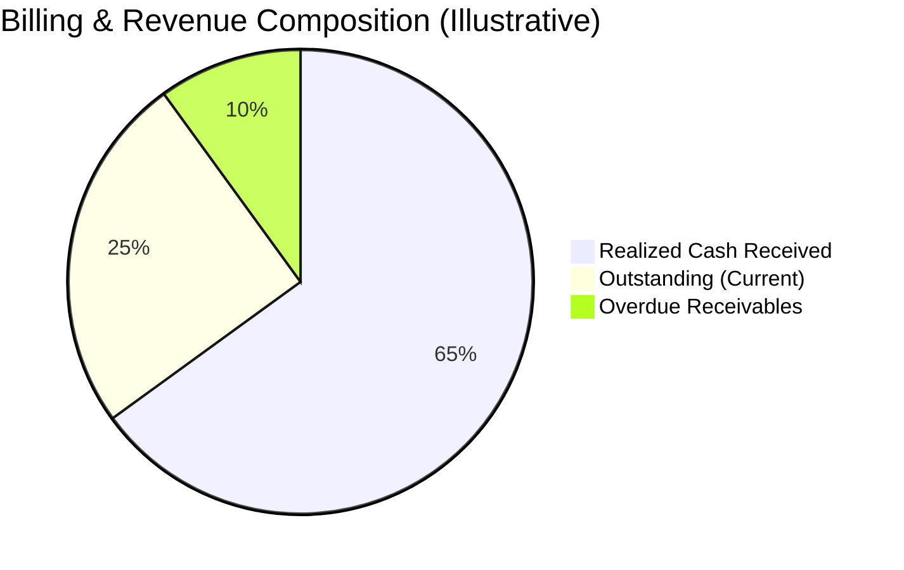

# Brightloop Subscription Management System — Dashboard KPI Definitions & Metrics Specification

## Document Overview
- **Document Version:** 1.0.0
- **Status:** Approved Baseline / Active
- **Module Ownership:** `brightloop_dashboard`, `brightloop_billing`, `brightloop_subscription`
- **Target ERP Platform:** Odoo 19 (Community/Enterprise)

---

## 1. Executive Summary & Financial Distinctions

A critical principle of Brightloop financial reporting is the strict segregation between:
1. **Accrual Invoiced Revenue:** Value of goods/services legally billed via posted invoices (accounts receivable credit), regardless of collection.
2. **Cash Received (Realized Cash Flow):** Actual cash funds collected and reconciled via payment journals into company bank accounts.
3. **Outstanding Receivables:** Contracted billed amounts currently unpaid by customers.



---

## 2. Core Dashboard KPI Specifications

### KPI-01: Active Subscriptions
- **Definition:** Total count of active, revenue-generating customer subscriptions currently entitled to services.
- **Metric Type:** Operational Volume (Count).
- **Accounting Nature:** Non-monetary contract count.
- **Source Model:** `brightloop.subscription`
- **Calculation Formula:**
  $$\text{Active Subscriptions} = \text{Count}(\text{subscription\_id})$$
- **ORM Domain / SQL Filter:**
  ```python
  [
      ('state', '=', 'active'),
      ('is_paused', '=', False),
      ('date_start', '<=', fields.Date.today()),
      '|',
      ('commitment_end_date', '=', False),
      ('commitment_end_date', '>=', fields.Date.today())
  ]
  ```
- **Date Range / Temporal Scope:** Snapshot as of current date/time.
- **Filters & Exclusions:**
  - Exclude `Draft`, `Quotation`, `Confirmed` (un-activated), and `Closed` records.
  - Exclude paused subscriptions (`is_paused = True`) or display them as a separate sub-metric: `Active (Paused)`.
- **Target Visualization:** Single KPI Scorecard with trend comparison ($\Delta$ vs previous month).

---

### KPI-02: Total Invoiced Revenue
- **Definition:** The aggregate monetary value of all legally posted customer invoices originated from subscription contracts within a selected date window.
- **Metric Type:** Accrual Revenue (Monetary).
- **Accounting Nature:** **Posted Invoiced Revenue (Accrual)**. Does *not* represent cash in bank.
- **Source Model:** `account.move` linked via `subscription_id`.
- **Calculation Formula:**
  $$\text{Invoiced Revenue} = \sum_{\text{invoices}} \text{amount\_untaxed\_signed}$$
  *(Or `amount_total_signed` depending on whether pre-tax or gross revenue toggle is selected; default is pre-tax `amount_untaxed_signed`)*.
- **ORM Domain / SQL Filter:**
  ```python
  [
      ('move_type', '=', 'out_invoice'),
      ('state', '=', 'posted'),
      ('subscription_id', '!=', False),
      ('invoice_date', '>=', start_date),
      ('invoice_date', '<=', end_date)
  ]
  ```
- **Date Range / Temporal Scope:** Filterable: Month-to-Date (MTD), Quarter-to-Date (QTD), Year-to-Date (YTD), or Custom Date Range.
- **Filters & Exclusions:**
  - **MUST EXCLUDE** `state == 'draft'` (pro-forma quotes are not revenue).
  - **MUST EXCLUDE** `state == 'cancel'` (voided transactions).
  - Reversal credit notes (`out_refund`) linked to subscriptions are subtracted automatically via signed amounts.
- **Target Visualization:** Monetary scorecard + Monthly revenue bar chart.

---

### KPI-03: Payments Received (Cash Flow)
- **Definition:** The net actual liquid cash funds successfully collected and reconciled from customers against subscription invoices within the selected date window.
- **Metric Type:** Cash Flow / Liquidity (Monetary).
- **Accounting Nature:** **Actual Cash Received (Cash Accounting)**. Distinct from posted invoices.
- **Source Model:** `account.payment` reconciled with subscription `account.move`.
- **Calculation Formula:**
  $$\text{Payments Received} = \sum_{\text{payments}} \text{amount\_company\_currency}$$
- **ORM Domain / SQL Filter:**
  ```python
  [
      ('payment_type', '=', 'inbound'),
      ('state', '=', 'posted'),
      ('reconciled_invoice_ids.subscription_id', '!=', False),
      ('date', '>=', start_date),
      ('date', '<=', end_date)
  ]
  ```
- **Date Range / Temporal Scope:** Filterable by transaction settlement date (`date`).
- **Filters & Exclusions:**
  - Exclude unconfirmed, draft, or cancelled payments.
  - Subtract customer refunds / chargebacks (`payment_type == 'outbound'`).
  - Does NOT include unallocated advances unless applied to a subscription receivable line.
- **Target Visualization:** Monetary scorecard + Cash vs. Invoiced revenue comparative line graph.

---

### KPI-04: Outstanding Receivables
- **Definition:** The total cumulative balance of unpaid, legally posted subscription invoices that are currently awaiting payment settlement.
- **Metric Type:** Balance Sheet Asset / Accounts Receivable (Monetary).
- **Accounting Nature:** **Unpaid Accrual Balance**.
- **Source Model:** `account.move`
- **Calculation Formula:**
  $$\text{Outstanding Receivables} = \sum_{\text{invoices}} \text{amount\_residual\_signed}$$
- **ORM Domain / SQL Filter:**
  ```python
  [
      ('move_type', '=', 'out_invoice'),
      ('state', '=', 'posted'),
      ('payment_state', 'in', ('not_paid', 'partial')),
      ('subscription_id', '!=', False)
  ]
  ```
- **Date Range / Temporal Scope:** Cumulative open balance as of current date (point-in-time snapshot).
- **Filters & Exclusions:**
  - Exclude fully settled invoices (`payment_state == 'paid'`).
  - Exclude cancelled or draft invoices.
  - Reflects net residual amount (e.g. if a $1,000 invoice was partially paid with $400, counts remaining $600).
- **Target Visualization:** Scorecard with aging breakdown indicator.

---

### KPI-05: Overdue Invoices & Past-Due Amount
- **Definition:** The monetary sum and count of posted subscription invoices whose payment due date (`invoice_date_due`) has passed without full payment.
- **Metric Type:** Credit Risk / Delinquency (Monetary & Count).
- **Accounting Nature:** **High-Risk Outstanding Receivables**.
- **Source Model:** `account.move`
- **Calculation Formula:**
  $$\text{Overdue Amount} = \sum_{\text{invoices}} \text{amount\_residual\_signed} \quad \text{where } \text{invoice\_date\_due} < \text{today}$$
  $$\text{Overdue Count} = \text{Count}(\text{invoice\_id}) \quad \text{where } \text{invoice\_date\_due} < \text{today}$$
- **ORM Domain / SQL Filter:**
  ```python
  [
      ('move_type', '=', 'out_invoice'),
      ('state', '=', 'posted'),
      ('payment_state', 'in', ('not_paid', 'partial')),
      ('invoice_date_due', '<', fields.Date.today()),
      ('subscription_id', '!=', False)
  ]
  ```
- **Aging Slices (Dunning Buckets):**
  - **Bucket 1 (1 - 15 days past due):** Grace period / Soft reminder stage.
  - **Bucket 2 (16 - 30 days past due):** Urgent dunning / suspension warning stage.
  - **Bucket 3 (30+ days past due):** Default risk / automated cancellation candidate.
- **Target Visualization:** Aging stacked bar chart + Total Overdue alert banner.

---

### KPI-06: Subscription Count by Status
- **Definition:** The distribution of all subscriptions in the database grouped by their current lifecycle state.
- **Metric Type:** Pipeline & Funnel Breakdown (Counts).
- **Accounting Nature:** Operational status distribution.
- **Source Model:** `brightloop.subscription`
- **Calculation Formula:**
  $$\text{Count}(S) \quad \forall S \in \{\text{Draft}, \text{Quotation}, \text{Confirmed}, \text{Active}, \text{Closed}\}$$
- **ORM Aggregation:**
  ```python
  self.env['brightloop.subscription'].read_group(
      domain=[],
      fields=['state'],
      groupby=['state']
  )
  ```
- **Target Visualization:** Donut chart / segmented funnel showing conversion ratios.

---

## 3. Performance Acceptance Criteria & Query Latency Targets

| Acceptance Parameter | Acceptance Threshold | Measurement Condition | Mitigation / Technical Requirement |
|---|---|---|---|
| **Dashboard Load Latency** | $< 1.5 \text{ seconds}$ | Cold cache load on database with $\ge 50,000$ active subscriptions and $500,000$ invoice lines. | 1. Direct PostgreSQL composite indexes on: `(subscription_id, state, invoice_date)`, `(state, payment_state, invoice_date_due)`.<br>2. Use ORM `read_group` or pre-aggregated materialized reporting views (`brightloop.subscription.report`). |
| **Filter Switch Response** | $< 500 \text{ ms}$ | User toggles date filter (MTD $\rightarrow$ YTD) or partner category filter in dashboard UI. | Client-side reactive chart re-rendering with cached backend JSON payloads. |
| **Materialized Refresh Cron** | $< 30 \text{ seconds}$ | Hourly materialized summary table computation cron. | Incremental update pattern evaluating only records modified since `last_sync_date`. |
| **Currency Consistency** | Exact to $0.01$ | Multi-currency conversions across USD, EUR, and GBP subscriptions. | All dashboard monetary aggregations must evaluate `amount_company_currency` converted using transaction-date exchange rates, preventing fictitious FX drift. |
