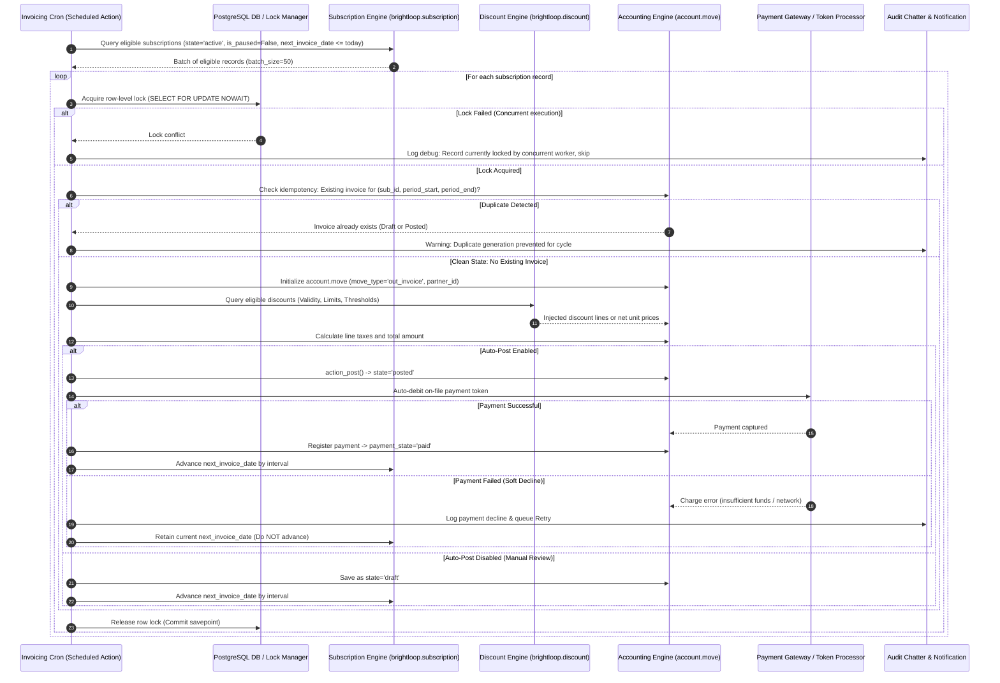
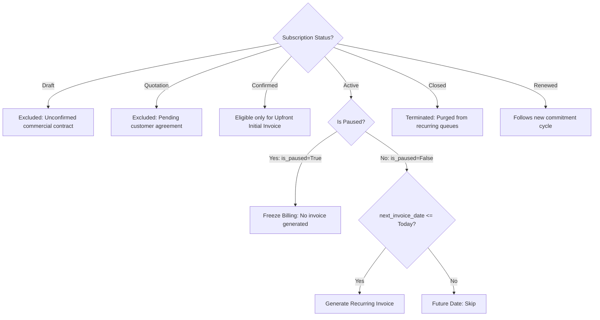
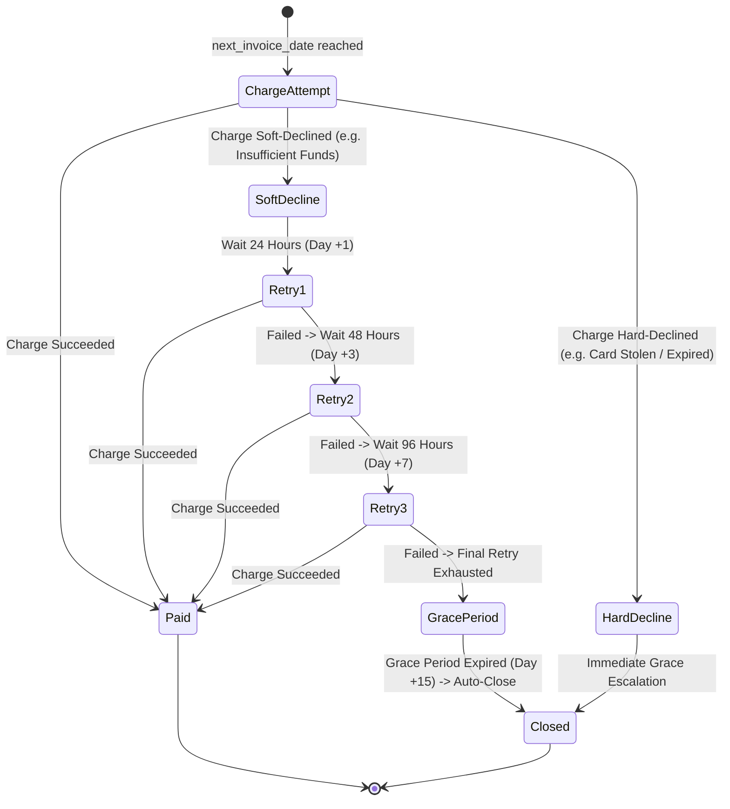

# Brightloop Subscription Management System — Recurring Billing Workflow Specification

## Document Overview
- **Document Version:** 1.0.0
- **Status:** Approved Baseline / Active
- **Module Ownership:** `brightloop_billing`, `brightloop_subscription`
- **Target ERP Platform:** Odoo 19 (Community/Enterprise)

---

## 1. High-Level Recurring Billing Pipeline

The diagram below details the end-to-end execution flow of the daily recurring billing engine (`ir.cron_generate_subscription_invoices`).



---

## 2. Supported Billing Cadences & Period Calculations

Brightloop supports four primary billing frequencies configured via `billing_interval_number` and `billing_interval_unit`:

| Cadence | `interval_unit` | `interval_number` | Billing Period (`period_start` to `period_end`) | Advance Next Date Formula |
|---|---|---|---|---|
| **Daily** | `day` | `1` | `T` to `T` (Same calendar day) | `T + 1 day` |
| **Weekly** | `week` | `1` | `T` to `T + 6 days` | `T + 7 days` |
| **Monthly** | `month` | `1` | `T` to $\text{NextDate} - 1 \text{ day}$ | Calendar Month with anchor day clamping |
| **Yearly** | `year` | `1` | `T` to $\text{NextDate} - 1 \text{ day}$ | `T + 1 calendar year` (Leap day Feb 29 $\rightarrow$ Feb 28) |

### Anchor-Preserving Monthly Arithmetic

To avoid degradation of dates (e.g. Jan 31 rolling to Feb 28 and remaining on 28 for March):
```python
def get_next_billing_date(anchor_day, current_billing_date, interval_months=1):
    """
    Computes the next billing date while strictly preserving the initial anchor day.
    """
    import calendar
    from dateutil.relativedelta import relativedelta

    target = current_billing_date + relativedelta(months=interval_months)
    max_days_in_target_month = calendar.monthrange(target.year, target.month)[1]
    clamped_day = min(anchor_day, max_days_in_target_month)
    return target.replace(day=clamped_day)
```

---

## 3. Subscription Status Billing Guards

The billing engine enforces strict operational guards based on the subscription's state:



### Operational Guard Rules

1. **Paused Subscriptions:**
   - When a subscription is paused (`is_paused = True`), recurring invoice generation is frozen.
   - Upon resumption, `next_invoice_date` is pushed forward by the exact number of days spent in paused status:
     $$\text{New Next Date} = \text{Old Next Date} + (\text{Resume Date} - \text{Pause Date})$$
2. **Closed Subscriptions:**
   - Once a contract enters `Closed` state, it is immediately excluded from the billing cron domain (`state = 'active'`).
   - If an invoice generation was in-flight when closure was requested, the transaction savepoint verifies state and aborts.
3. **Renewed Subscriptions:**
   - Subscriptions reaching the end of their commitment with `auto_renew = True` extend `commitment_end_date` without interrupting the recurring billing cadence.
4. **Failed Invoice Creation Rollback:**
   - If an unhandled database exception (e.g., account lock, foreign key error, unmapped fiscal position) occurs during invoice creation, the entire invoice generation for that specific subscription is rolled back to a database savepoint.
   - The cron logs the exception to the subscription chatter, flags `billing_error = True`, and continues processing subsequent subscriptions in the batch without halting the worker.

---

## 4. Dunning & Retry Automation Sequence



### Dunning Communication Matrix

| Stage | Trigger Timing | System Action | Customer Notification |
|---|---|---|---|
| **Initial Failure** | Day 0 | Payment transaction logged as `error`. Invoice remains `posted`. | Email: "Payment Failed — Retrying in 24 hours". |
| **Retry #1** | Day 1 (+24h) | Automated cron re-attempts token charge. | Email (if failed): "Second Payment Attempt Failed — Please verify payment method". |
| **Retry #2** | Day 3 (+72h) | Automated cron re-attempts token charge. | Email (if failed): "Urgent: Payment Needed — Service suspension warning". |
| **Retry #3** | Day 7 (+168h) | Final automated charge attempt. | Email (if failed): "Final Payment Failure Notice — Grace period active until Day 15". |
| **Auto-Closure** | Day 15 (Grace end) | Subscription state $\rightarrow$ `Closed`. Access revoked. | Email: "Subscription Cancelled for Non-Payment — Final statement attached". |
