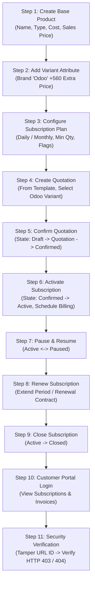

# Brightloop Subscription Management System — Evaluator Walkthrough & Demonstration Guide

## Document Overview
- **Document Version:** 1.0.0
- **Target Audience:** Assignment Evaluators, Code Reviewers, and Lead Developers
- **Scope:** Step-by-step walkthrough demonstrating the full subscription lifecycle, product variant pricing, customer portal self-service, and security boundaries in Odoo 19 Enterprise.

---

## 1. Demonstration Prerequisites & Test Credentials

| Role | Username / Email | Password | Access Level |
|---|---|---|---|
| **Administrator** | `admin` | *(System Master Password)* | Full system control |
| **Internal Staff** | `staff@brightloop.test` | `StaffPass2026!` | Operational subscription management |
| **Customer A** | `customer.a@brightloop.test` | `CustomerA2026!` | Portal access for Customer A (Delta Retail) |
| **Customer B** | `customer.b@brightloop.test` | `CustomerB2026!` | Portal access for Customer B (Global Corp) |

---

## 2. 11-Step End-to-End Walkthrough Sequence

---

### Step 1: Create Base Subscription Product
1. Log in as **Administrator**.
2. Navigate to **Subscriptions > Products > Products**.
3. Click **New**.
4. Set:
   - **Product Name:** `Brightloop Business Cloud`
   - **Product Type:** `Service`
   - **Sales Price:** `1000.00`
   - **Cost Price:** `300.00`
   - **Internal Notes:** `Core cloud enterprise software subscription.`
   - **Can be Subscribed (Recurring):** Checked.
5. Click **Save**.

---

### Step 2: Configure Product Variant (Brand "Odoo" +560 Extra Price)
1. On the product form, navigate to the **Attributes & Variants** tab.
2. Click **Add a line**:
   - **Attribute:** `Brand`
   - **Values:**
     - `Standard` (Price Extra: `0.00`)
     - `Odoo` (Price Extra: `560.00`)
3. Click **Save**.
4. Click the **Product Variants** stat button at the top:
   - Notice two variants generated:
     - `Brightloop Business Cloud (Brand: Standard)` $\rightarrow$ List Price = **$1000.00**
     - `Brightloop Business Cloud (Brand: Odoo)` $\rightarrow$ List Price = **$1560.00** ($1000 + 560$).

---

### Step 3: Configure Subscription Plan
1. Navigate to **Subscriptions > Configuration > Subscription Plans**.
2. Click **New**.
3. Set:
   - **Plan Name:** `Enterprise Monthly`
   - **Billing Recurrence:** `1 Month` (or test `1 Day` for Daily recurrence)
   - **Minimum Quantity:** `2`
   - **Availability Dates:** Start: First day of current month; End: Dec 31, 2026.
   - **Auto-Close on Expiry:** Checked.
   - **Allow Early Closure:** Checked.
   - **Allow Pause & Resume:** Checked.
   - **Allow Renewal:** Checked.
4. Click **Save**.

---

### Step 4: Create a Subscription Quotation
1. Navigate to **Subscriptions > Quotations > New**.
2. Select:
   - **Customer:** `Delta Retail`
   - **Plan:** `Enterprise Monthly`
3. Under Subscription Lines, click **Add a line**:
   - **Product:** `Brightloop Business Cloud (Brand: Odoo)`
   - Notice the **Unit Price** automatically populates as **$1560.00**.
   - Set **Quantity:** `2` (complies with plan minimum quantity $\ge 2$).
   - Notice **Subtotal** computes as $2 \times 1560.00 = \mathbf{\$3120.00}$.
4. Click **Save**. The record is in **`Draft`** state.
5. Click **Create Quotation**.
   - Unique sequence number is generated (e.g., `SUB/2026/00001`).
   - State transitions from **`Draft`** $\rightarrow$ **`Quotation`**.

---

### Step 5: Confirm the Subscription
1. Click **Confirm**.
2. State transitions from **`Quotation`** $\rightarrow$ **`Confirmed`**.
3. Chatter records the confirmation action and timestamp.

---

### Step 6: Activate the Subscription
1. Click **Activate Subscription**.
2. State transitions from **`Confirmed`** $\rightarrow$ **`Active`**.
3. **Start Date** is initialized to today.
4. **Next Billing Date** is calculated and scheduled based on the plan recurrence (e.g. today + 1 month).

---

### Step 7: Pause and Resume Workflow
1. While in **`Active`** state, click **Pause Subscription**.
2. System flags `is_paused = True`. Chatter records: *"Subscription paused by staff"*.
3. Scheduled billing is suspended during pause.
4. Click **Resume Subscription**.
5. System clears pause flag and reactivates recurring billing schedule.

---

### Step 8: Renew the Subscription
1. On the active contract, click **Renew**.
2. System creates a linked renewal quotation or extends the contract period.
3. Chatter logs the renewal event referencing the parent agreement.

---

### Step 9: Close the Subscription Early
1. Click **Close Subscription**.
2. Select close reason (e.g., *"Customer Downsizing"* or *"Project Completed"*).
3. System verifies plan allows early closure (`allow_early_closure == True`).
4. State moves to **`Closed`**.
5. Future recurring billing is terminated immediately.

---

### Step 10: Log In as Customer to the Self-Service Portal
1. Open a private/incognito browser window.
2. Navigate to `http://localhost:8069/web/login`.
3. Log in as Customer A:
   - **Email:** `customer.a@brightloop.test`
   - **Password:** `CustomerA2026!`
4. Open the **Subscriptions** tile or browse to `/my/subscriptions`.
5. View the list of subscriptions:
   - Delta Retail's subscription `SUB/2026/00001` is visible with plan, dates, and total.
6. Click into `SUB/2026/00001` to view line items, variant details ("Brand: Odoo"), and invoice history.

---

### Step 11: Verify Cross-Customer Security Restrictions
1. While still logged in as Customer A, attempt to tamper with the URL in the address bar:
   - Change URL from `/my/subscriptions/1` to `/my/subscriptions/2` (Customer B's subscription ID).
2. Press Enter.
3. **Verified Result:** System immediately returns **HTTP 403 Forbidden** or **HTTP 404 Not Found**.
4. Customer A is completely prevented from viewing Customer B's records, proving strict data isolation and zero cross-tenant leakage.
