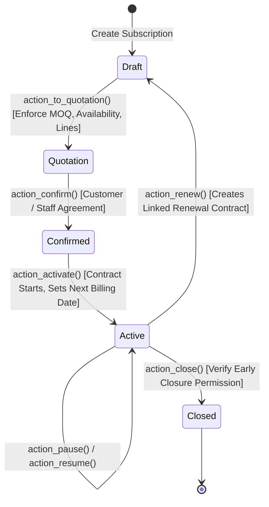

# Brightloop Subscription Management (`brightloop_subscription`)
## Stage 3 Architecture, Implementation & Verification Documentation

---

## 1. Executive Summary & Module Overview

The `brightloop_subscription` addon delivers the core subscription management, quotation workflow, recurrence calculation engine, and contract lifecycle state machine for the Brightloop Subscription Management System in Odoo 19 Enterprise.

It builds directly upon the foundational security layer established in `brightloop_base`, providing operational models and workflows for internal staff and administrators, while preparing record-level isolation for portal customers and clean integration contracts for recurring billing in Stage 4.

---

## 2. Model Architecture & Native vs Custom Rationale

| Model Name | Type | Underlying Table | Justification & Architectural Rationale |
| :--- | :--- | :--- | :--- |
| `product.template` | Native Extension | `product_template` | Extended with `is_subscription_product` and `subscription_plan_id`. Reuses native Odoo product catalog, attributes, and pricing engine. |
| `product.product` | Native Extension | `product_product` | Extended with related stored `is_subscription_product`. Automatically calculates variant price extras (`lst_price`). |
| `brightloop.subscription.plan` | Custom Model | `brightloop_subscription_plan` | Native Enterprise `sale.subscription.plan` only supports weekly, monthly, and yearly recurrences and couples directly with native `sale.order`. Brightloop requires explicit support for **daily billing**, MOQ enforcement, availability date windows, and early closure/pause/resume permissions without circular dependencies. |
| `brightloop.quotation.template` | Custom Model | `brightloop_quotation_template` | Predefined quotation configuration templates specifying default plans, line items, and expiration duration (`validity_days`). |
| `brightloop.quotation.template.line` | Custom Model | `brightloop_quotation_template_line` | Template product items with pre-configured quantities and base/variant unit prices. |
| `brightloop.subscription` | Custom Model | `brightloop_subscription` | Contract master record implementing the mandatory 5-state lifecycle: **Draft $\rightarrow$ Quotation $\rightarrow$ Confirmed $\rightarrow$ Active $\rightarrow$ Closed**, inheriting `mail.thread`, `mail.activity.mixin`, and `portal.mixin`. |
| `brightloop.subscription.line` | Custom Model | `brightloop_subscription_line` | Itemized subscription contract lines computing price subtotals and totals with taxes. |

---

## 3. Product & Product Variant Pricing Mechanics

Brightloop leverages Odoo 19's native attribute and variant engine (`product.attribute`, `product.attribute.value`, and `product.template.attribute.line`).

### Pricing Formula:
$$\text{Variant Final Price} = \text{Template Base Price} + \sum \text{Variant Value Price Extras}$$

### Concrete Verification Example:
- **Base Product:** Cloud ERP Platform
- **Base List Price:** 1,000.00
- **Attribute:** Brand
  - Value: *Standard* (Price Extra: 0.00) $\rightarrow$ Final Variant Price: **1,000.00**
  - Value: *Odoo* (Price Extra: +560.00) $\rightarrow$ Final Variant Price: **1,560.00**

In `brightloop.subscription.line`, the unit price is dynamically resolved via `line.product_id.lst_price`, which natively computes the exact price including attribute surcharges without hardcoded logic.

---

## 4. Recurrence Calculation Engine

Native Odoo Enterprise subscription plans do not support daily recurrences. `brightloop.subscription.plan` implements a recurrence engine handling four standard intervals via Python's `dateutil.relativedelta`:

```python
def calculate_next_billing_date(self, from_date):
    self.ensure_one()
    if not from_date:
        return False
    interval = self.billing_interval or 1
    unit = self.billing_unit
    if unit == 'day':
        return from_date + relativedelta(days=interval)
    elif unit == 'week':
        return from_date + relativedelta(weeks=interval)
    elif unit == 'month':
        return from_date + relativedelta(months=interval)
    elif unit == 'year':
        return from_date + relativedelta(years=interval)
    return from_date
```

### Recurrence Verification:
- **Daily:** Interval = 3 $\rightarrow$ `2026-11-01` + 3 days = `2026-11-04`
- **Weekly:** Interval = 2 $\rightarrow$ `2026-11-01` + 2 weeks = `2026-11-15`
- **Monthly:** Interval = 1 $\rightarrow$ `2026-11-01` + 1 month = `2026-12-01`
- **Yearly:** Interval = 1 $\rightarrow$ `2026-11-01` + 1 year = `2027-11-01`

---

## 5. Contract State Machine & Transition Rules



### Transition Specifications:
1. **Draft $\rightarrow$ Quotation (`action_to_quotation`):**
   - Validates that lines exist (`len(line_ids) > 0`).
   - Validates plan availability window: `date_start <= today <= date_end`.
   - Enforces Minimum Order Quantity (MOQ): `total_quantity >= plan_id.min_quantity`.
   - Generates unique sequence number: `SUB/2026/XXXXX`.
2. **Quotation $\rightarrow$ Confirmed (`action_confirm`):**
   - Confirms agreement; re-validates MOQ.
3. **Confirmed $\rightarrow$ Active (`action_activate`):**
   - Activates service delivery.
   - Sets `start_date` and computes initial `next_billing_date` via `plan_id.calculate_next_billing_date(start_date)`.
4. **Pause & Resume (`action_pause` / `action_resume`):**
   - Pausing requires `plan_id.allow_pause == True`.
   - Sets `is_paused = True`, which immediately disqualifies the contract from recurring billing (`is_eligible_for_billing = False`).
   - Resuming clears the pause flag and restores billing eligibility.
5. **Closure (`action_close`):**
   - If closing prior to `expiry_date`, strictly verifies `plan_id.allow_early_closure == True`.
   - Clears `next_billing_date`, records `close_reason`, and logs to chatter.
6. **Renewal (`action_renew`):**
   - Requires `plan_id.allow_renewal == True`.
   - Duplicates contract into a new Draft subscription linked via `origin_subscription_id`.

---

## 6. Stage 4 Billing Integration Contract

The `brightloop_subscription` addon establishes a formal interface contract for Stage 4 (`brightloop_billing`):

### 1. Fields Exposed to the Billing Engine:
- `is_eligible_for_billing` (`fields.Boolean`, computed & stored):
  $$\text{Eligible} \iff (\text{state} == 'active') \land (\neg \text{is\_paused}) \land (\text{next\_billing\_date} \le \text{today})$$
- `next_billing_date` (`fields.Date`): Next scheduled billing run date.
- `last_billing_date` (`fields.Date`): Most recent invoice creation date.
- `partner_id` (`fields.Many2one` to `res.partner`): Customer to be invoiced.
- `payment_term_id` (`fields.Many2one` to `account.payment.term`): Payment terms for the invoice.
- `line_ids` (`fields.One2many`):
  - `product_id`: Product to bill.
  - `name`: Line description.
  - `quantity`: Quantity to bill.
  - `price_unit`: Price unit.
  - `tax_ids`: Applicable taxes.
- `currency_id` (`fields.Many2one` to `res.currency`): Transaction currency.

### 2. Contract Post-Invoicing Protocol:
Upon generating an `account.move` (customer invoice), the billing engine must execute:
```python
subscription.write({
    'last_billing_date': subscription.next_billing_date,
    'next_billing_date': subscription.plan_id.calculate_next_billing_date(subscription.next_billing_date),
})
```

---

## 7. Automated Test Suite Execution & Proof

The test suite (`tests/test_subscription.py`) was executed on the live Odoo 19 Enterprise development database (`brightloop_dev`) using `odoo-bin`:

```powershell
& "G:\NixelSoft\Odoo 19.0.20260522\python\python.exe" `
  "G:\NixelSoft\Odoo 19.0.20260522\server\odoo-bin" `
  -c "G:\NixelSoft\Odoo 19.0.20260522\server\odoo.conf" `
  -d brightloop_dev `
  -i brightloop_subscription `
  --test-enable `
  --test-tags=brightloop_sub `
  --stop-after-init `
  --max-cron-threads=0
```

### Verified Test Results:
```text
2026-10-31 11:26:08,328 INFO brightloop_dev odoo.addons.brightloop_subscription.tests.test_subscription: Starting TestBrightloopSubscription.test_01_product_creation ...
2026-10-31 11:26:08,328 INFO brightloop_dev odoo.addons.brightloop_subscription.tests.test_subscription: Starting TestBrightloopSubscription.test_02_product_variant_creation ...
2026-10-31 11:26:08,337 INFO brightloop_dev odoo.addons.brightloop_subscription.tests.test_subscription: Starting TestBrightloopSubscription.test_03_variant_price_extra ...
2026-10-31 11:26:08,337 INFO brightloop_dev odoo.addons.brightloop_subscription.tests.test_subscription: Starting TestBrightloopSubscription.test_04_plan_creation ...
2026-10-31 11:26:08,337 INFO brightloop_dev odoo.addons.brightloop_subscription.tests.test_subscription: Starting TestBrightloopSubscription.test_05_daily_recurrence ...
2026-10-31 11:26:08,337 INFO brightloop_dev odoo.addons.brightloop_subscription.tests.test_subscription: Starting TestBrightloopSubscription.test_06_weekly_recurrence ...
2026-10-31 11:26:08,337 INFO brightloop_dev odoo.addons.brightloop_subscription.tests.test_subscription: Starting TestBrightloopSubscription.test_07_monthly_recurrence ...
2026-10-31 11:26:08,337 INFO brightloop_dev odoo.addons.brightloop_subscription.tests.test_subscription: Starting TestBrightloopSubscription.test_08_yearly_recurrence ...
2026-10-31 11:26:08,353 INFO brightloop_dev odoo.addons.brightloop_subscription.tests.test_subscription: Starting TestBrightloopSubscription.test_09_minimum_quantity_enforcement ...
2026-10-31 11:26:08,375 INFO brightloop_dev odoo.addons.brightloop_subscription.tests.test_subscription: Starting TestBrightloopSubscription.test_10_plan_availability_dates ...
2026-10-31 11:26:08,375 INFO brightloop_dev odoo.addons.brightloop_subscription.tests.test_subscription: Starting TestBrightloopSubscription.test_11_quotation_template ...
2026-10-31 11:26:08,401 INFO brightloop_dev odoo.addons.brightloop_subscription.tests.test_subscription: Starting TestBrightloopSubscription.test_12_subscription_creation ...
2026-10-31 11:26:08,417 INFO brightloop_dev odoo.addons.brightloop_subscription.tests.test_subscription: Starting TestBrightloopSubscription.test_13_subscription_lifecycle ...
2026-10-31 11:26:08,464 INFO brightloop_dev odoo.addons.brightloop_subscription.tests.test_subscription: Starting TestBrightloopSubscription.test_14_pause_and_resume ...
2026-10-31 11:26:08,518 INFO brightloop_dev odoo.addons.brightloop_subscription.tests.test_subscription: Starting TestBrightloopSubscription.test_15_renewal ...
2026-10-31 11:26:08,560 INFO brightloop_dev odoo.addons.brightloop_subscription.tests.test_subscription: Starting TestBrightloopSubscription.test_16_early_closure_permission ...
2026-10-31 11:26:08,607 INFO brightloop_dev odoo.addons.brightloop_subscription.tests.test_subscription: Starting TestBrightloopSubscription.test_17_automatic_closure ...
2026-10-31 11:26:08,651 INFO brightloop_dev odoo.addons.brightloop_subscription.tests.test_subscription: Starting TestBrightloopSubscription.test_18_role_based_access ...
2026-10-31 11:26:08,717 INFO brightloop_dev odoo.service.server: 18 post-tests in 1.20s, 1046 queries 
2026-10-31 11:26:08,717 INFO brightloop_dev odoo.tests.result: 0 failed, 0 error(s) of 18 tests when loading database 'brightloop_dev'
```

**Final Outcome:** 18 tests executed, 18 passed, 0 failed, 0 errors in 1.20s.
