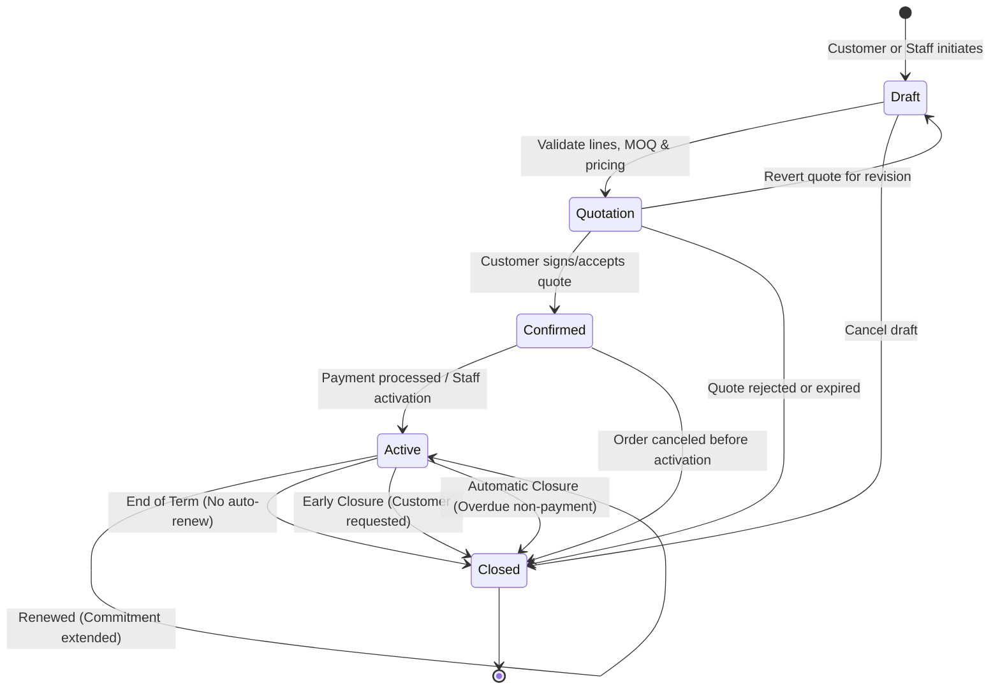
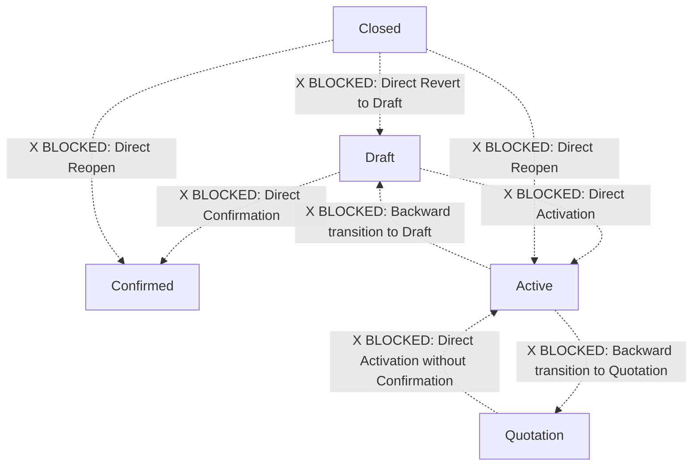
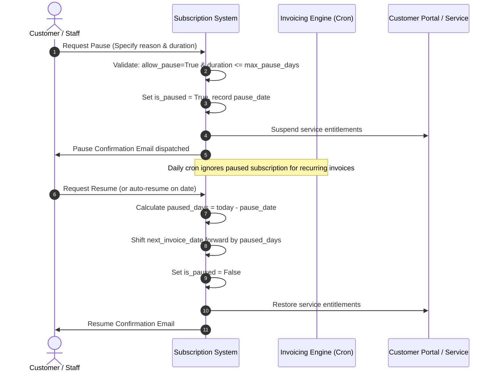
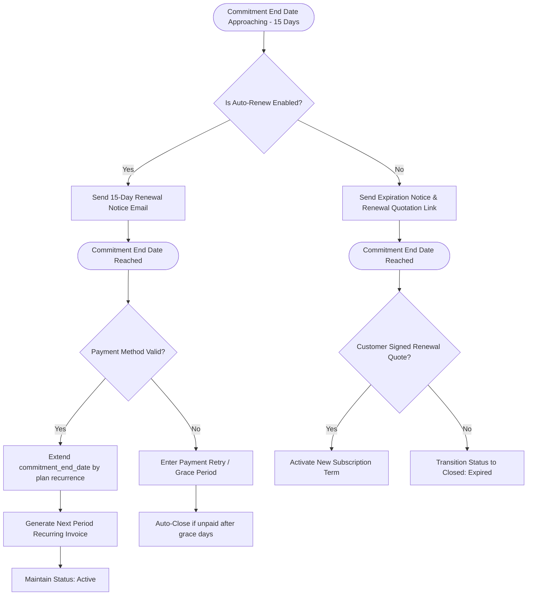

# Brightloop Subscription Management System — Subscription Lifecycle & Workflow Specification

## Document Overview
- **Document Version:** 1.0.0
- **Status:** Baseline Approved
- **Scope:** Complete state machine, business workflows, valid & invalid transitions, boundary conditions, and exception rules for Brightloop subscriptions.

---

## 1. High-Level State Machine Diagram

---

## 2. Comprehensive State Transition Matrix

The table below defines all possible state transitions across the core subscription model (`brightloop.subscription`).

| From State | To State | Transition Name | Allowed Roles | Trigger Condition | Validating Preconditions | Side Effects & Actions |
|---|---|---|---|---|---|---|
| **None** | `Draft` | Create Subscription | STAF, MGR, CUST (Portal) | User clicks "New" or initiates online order | None | Generates sequential draft reference `SUB/DRAFT/XXXXX`. |
| `Draft` | `Quotation` | Send / Confirm Quote | STAF, MGR | Staff finishes drafting pricing lines and clicks "Send Quotation" | 1. Customer (`partner_id`) specified. 2. Active subscription plan selected. 3. At least 1 subscription line with Qty $\ge$ MOQ. 4. Unit prices $> 0$. | State becomes `Quotation`. Generates formal reference `SUB/2026/XXXXX`. PDF quotation generated. Validity date set. |
| `Draft` | `Closed` | Cancel Draft | STAF, MGR | Customer declines to proceed or staff aborts | None | State becomes `Closed`. Close reason logged as "Canceled in Draft". |
| `Quotation` | `Draft` | Revise Quotation | STAF, MGR | Customer requests price or seat modification | Quotation not yet accepted or expired | State reverts to `Draft`. Existing quotation PDF invalidated. |
| `Quotation` | `Confirmed` | Accept Quotation | CUST (Portal), STAF, MGR | Customer electronically signs quotation via portal or staff records offline acceptance | 1. Current date $\le$ validity date. 2. Valid electronic signature or staff confirmation provided. | State becomes `Confirmed`. Signature timestamp, signer IP address, and digital token saved. Chatter notification posted. |
| `Quotation` | `Closed` | Expire / Decline | SYSTEM (Cron), CUST, STAF | Expiration date passed without acceptance, or customer clicks "Decline" in portal | Date $>$ `validity_date` OR explicit decline action | State becomes `Closed`. Close reason set to "Expired" or "Customer Declined". |
| `Confirmed` | `Active` | Activate Subscription | SYSTEM (Webhook), STAF, MGR | Payment token verified, upfront invoice settled, or staff manual override | 1. Payment confirmation received OR credit terms approved. 2. Customer billing profile validated. | State becomes `Active`. `date_start` recorded (defaults to today). `next_invoice_date` initialized. Service provisioning signal dispatched. |
| `Confirmed` | `Closed` | Cancel Order | STAF, MGR | Customer cancels before activation or payment fails authorization | Subscription not yet transitioned to `Active` | State becomes `Closed`. Reason set to "Canceled Prior to Activation". Any pre-auth held funds released. |
| `Active` | `Active` (Paused) | Pause Subscription | STAF, MGR | Customer temporary leave or suspension request | 1. Plan allows pausing (`allow_pause = True`). 2. Duration within plan limits (e.g., max 60 days). 3. No unpaid overdue invoices. | `is_paused = True`. `pause_date` recorded. Service access suspended. Recurring invoice cron freezes billing generation. |
| `Active` (Paused) | `Active` (Running) | Resume Subscription | STAF, MGR | Customer returns or pause expiration date reached | Subscription is currently paused | `is_paused = False`. `next_invoice_date` adjusted by elapsed pause duration. Service access restored. |
| `Active` | `Active` (Renewed) | Renew Subscription | SYSTEM (Cron), STAF | Commitment period expires with `auto_renew = True` | 1. Auto-renew enabled. 2. Account in good financial standing. 3. Active payment method on file. | `commitment_end_date` extended by plan renewal interval. Renewal confirmation email sent. Next cycle invoice created. |
| `Active` | `Closed` | Standard Expiration | SYSTEM (Cron), STAF | Contract end date reached without auto-renewal | `auto_renew = False` and `today >= commitment_end_date` | State becomes `Closed`. Close reason: "Contract Term Completed". Access revoked. |
| `Active` | `Closed` | Early Termination | MGR | Customer requests cancellation prior to contract end date | Mandatory closure reason code selected | State becomes `Closed`. `date_closed` recorded. Early termination penalty fee calculated and added to final settlement invoice if applicable. |
| `Active` | `Closed` | Automatic Closure (Default) | SYSTEM (Cron) | Recurring invoice remains unpaid past plan grace period threshold (e.g., 15 days) | 1. Overdue invoices exist. 2. Exceeded plan `grace_period_days`. 3. DUNNING escalation sequence completed. | State becomes `Closed`. Reason: "Automatic Closure: Non-Payment". Portal access revoked. Notification sent to customer and finance team. |

---

## 3. Disallowed (Invalid) Transitions

To prevent data corruption, financial inaccuracies, and unauthorized access, the following state transitions are **strictly rejected** by model constraints:

### Detailed Invalid Transition Constraints

1. **`Draft` $\rightarrow$ `Active` (Direct Activation):**
   - **Rule:** A subscription cannot bypass the formal quote and customer confirmation phase.
   - **System Enforcement:** Python ValidationError: `"Subscriptions cannot be activated directly from Draft state. They must first be quoted and confirmed."`
2. **`Quotation` $\rightarrow$ `Active` (Unconfirmed Activation):**
   - **Rule:** Staff cannot activate a quotation without recording customer agreement (`Confirmed` status).
   - **System Enforcement:** Python ValidationError: `"Cannot activate unconfirmed quotation. Confirm the quotation prior to activation."`
3. **`Active` $\rightarrow$ `Draft` / `Quotation` (Backward State Movement):**
   - **Rule:** Active commercial contracts that have generated invoices or provisioned services cannot revert to preliminary draft states.
   - **System Enforcement:** Python UserError: `"Active subscriptions cannot be moved backward to Draft or Quotation. Use amendments or cancellation."`
4. **`Closed` $\rightarrow$ `Active` / `Confirmed` / `Draft` (Direct Reopening):**
   - **Rule:** A closed contract is legally terminal. Once marked `Closed`, records become read-only archives for audit and compliance.
   - **System Enforcement:** Python UserError: `"Closed subscriptions cannot be reopened. Please generate a new renewal quotation."`

---

## 4. Special Operational Scenarios

### 4.1 Subscription Pause and Resume Workflow

### 4.2 Auto-Renewal vs Manual Renewal Scenarios

### 4.3 Early Closure vs Automatic Non-Payment Closure

| Aspect | Early Closure (Voluntary) | Automatic Closure (Involuntary) |
|---|---|---|
| **Initiated By** | Customer or Account Manager | System Automated Cron |
| **Trigger Event** | Customer request or mutual contract cancellation | Unpaid invoices exceeding plan grace period threshold (e.g., 15 days past due) |
| **Applicable Fees** | Early termination fee computed if within minimum commitment period | Full outstanding balance flagged for recovery |
| **Effective Date** | Immediate or end of current paid billing cycle | Immediate upon grace period expiry |
| **Invoice Handling** | Unbilled pro-rated usage invoiced immediately | Unpaid invoices marked past-due; future recurrence cancelled |
| **Audit Logging** | Chatter records requested user, approval manager, and selected reason code | Chatter records automated system log with referenced unpaid invoice IDs |

---

## 5. Role-Based Permissions & State Modification Matrix

| Operation | CUST (Portal Customer) | EVAL (Evaluator) | STAF (Subscription Staff) | MGR (Subscription Manager) |
|---|---|---|---|---|
| Create Draft Subscription | Yes (via cart) | Read-only | Yes | Yes |
| Edit Lines & Pricing in Draft | No | No | Yes | Yes |
| Send Formal Quotation | No | No | Yes | Yes |
| Accept / Sign Quotation | Yes | No | Yes (offline) | Yes |
| Confirm Subscription | No | No | Yes | Yes |
| Activate Subscription | No | No | Yes | Yes |
| Pause Active Subscription | Request only | No | Yes | Yes |
| Resume Active Subscription | Request only | No | Yes | Yes |
| Execute Early Closure | Request only | No | No (Requires approval) | Yes |
| Configure Plans & Templates | No | Read-only | No | Yes |
| Delete Closed / Draft Records | No | No | No | Yes (Draft only) |
